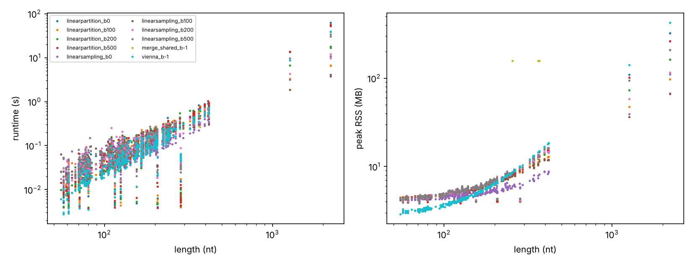
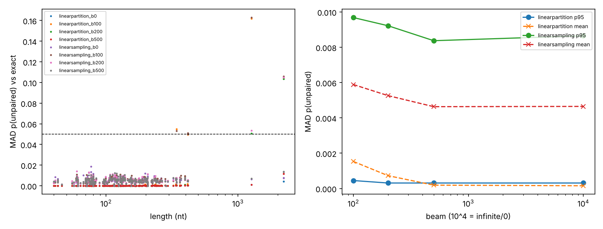

# Gap 4 benchmark + Gap 3a bias audit: results

Auto-generated by scripts/06_report.py. Scores on held-out RNAs only. Spearman/AUC = p(unpaired) vs normalised reactivity; 95% CI = bootstrap over RNAs. bp F1/MCC = pairs with p>0.5 vs reference dot-bracket.

## Leaderboard per length stratum

| stratum   | tool                 |   n_rna |   spearman |   sp_lo |   sp_hi |   auc |   auc_lo |   auc_hi |   n_ref |   bp_f1 |   bp_mcc |
|:----------|:---------------------|--------:|-----------:|--------:|--------:|------:|---------:|---------:|--------:|--------:|---------:|
| 1000-3000 | linearpartition_b100 |       3 |      0.129 |  -0.163 |   0.289 | 0.595 |    0.441 |    0.685 |       0 | nan     |  nan     |
| 1000-3000 | linearsampling_b100  |       3 |      0.129 |  -0.164 |   0.287 | 0.594 |    0.441 |    0.684 |       0 | nan     |  nan     |
| 1000-3000 | linearsampling_b200  |       3 |      0.116 |  -0.154 |   0.288 | 0.592 |    0.453 |    0.681 |       0 | nan     |  nan     |
| 1000-3000 | linearpartition_b200 |       3 |      0.114 |  -0.154 |   0.287 | 0.591 |    0.453 |    0.681 |       0 | nan     |  nan     |
| 1000-3000 | vienna_b-1           |       3 |      0.107 |  -0.185 |   0.291 | 0.590 |    0.438 |    0.673 |       0 | nan     |  nan     |
| 1000-3000 | linearsampling_b500  |       3 |      0.106 |  -0.184 |   0.286 | 0.588 |    0.438 |    0.682 |       0 | nan     |  nan     |
| 1000-3000 | linearpartition_b0   |       3 |      0.106 |  -0.184 |   0.290 | 0.589 |    0.440 |    0.685 |       0 | nan     |  nan     |
| 1000-3000 | linearsampling_b0    |       3 |      0.106 |  -0.184 |   0.288 | 0.589 |    0.439 |    0.685 |       0 | nan     |  nan     |
| 1000-3000 | linearpartition_b500 |       3 |      0.105 |  -0.183 |   0.286 | 0.588 |    0.439 |    0.681 |       0 | nan     |  nan     |
| 200-1000  | merge_shared_b-1     |       3 |      0.629 |   0.533 |   0.735 | 0.804 |    0.736 |    0.843 |       1 |   0.257 |    0.257 |
| 200-1000  | linearpartition_b200 |      87 |      0.375 |   0.321 |   0.424 | 0.741 |    0.720 |    0.762 |      47 |   0.603 |    0.605 |
| 200-1000  | linearpartition_b0   |      87 |      0.375 |   0.326 |   0.428 | 0.741 |    0.718 |    0.761 |      47 |   0.603 |    0.605 |
| 200-1000  | linearpartition_b500 |      87 |      0.375 |   0.322 |   0.426 | 0.741 |    0.719 |    0.762 |      47 |   0.603 |    0.605 |
| 200-1000  | vienna_b-1           |      87 |      0.375 |   0.323 |   0.424 | 0.741 |    0.719 |    0.761 |      47 |   0.603 |    0.605 |
| 200-1000  | linearsampling_b500  |      87 |      0.375 |   0.321 |   0.427 | 0.741 |    0.720 |    0.763 |      47 |   0.601 |    0.604 |
| 200-1000  | linearpartition_b100 |      87 |      0.375 |   0.323 |   0.428 | 0.741 |    0.719 |    0.762 |      47 |   0.603 |    0.605 |
| 200-1000  | linearsampling_b0    |      87 |      0.374 |   0.324 |   0.422 | 0.741 |    0.719 |    0.761 |      47 |   0.605 |    0.608 |
| 200-1000  | linearsampling_b100  |      87 |      0.374 |   0.325 |   0.423 | 0.741 |    0.720 |    0.762 |      47 |   0.601 |    0.604 |
| 200-1000  | linearsampling_b200  |      87 |      0.373 |   0.321 |   0.424 | 0.740 |    0.718 |    0.761 |      47 |   0.603 |    0.606 |
| <200      | linearsampling_b100  |     299 |      0.445 |   0.420 |   0.469 | 0.744 |    0.730 |    0.757 |     149 |   0.775 |    0.779 |
| <200      | linearsampling_b200  |     299 |      0.445 |   0.421 |   0.471 | 0.744 |    0.732 |    0.758 |     149 |   0.773 |    0.776 |
| <200      | vienna_b-1           |     299 |      0.445 |   0.421 |   0.468 | 0.745 |    0.731 |    0.758 |     149 |   0.773 |    0.776 |
| <200      | linearpartition_b0   |     299 |      0.445 |   0.420 |   0.471 | 0.745 |    0.730 |    0.759 |     149 |   0.773 |    0.776 |
| <200      | linearpartition_b200 |     299 |      0.445 |   0.420 |   0.470 | 0.745 |    0.730 |    0.759 |     149 |   0.773 |    0.776 |
| <200      | linearpartition_b500 |     299 |      0.445 |   0.419 |   0.470 | 0.745 |    0.730 |    0.758 |     149 |   0.773 |    0.776 |
| <200      | linearpartition_b100 |     299 |      0.445 |   0.421 |   0.471 | 0.745 |    0.731 |    0.758 |     149 |   0.773 |    0.776 |
| <200      | linearsampling_b500  |     299 |      0.444 |   0.421 |   0.469 | 0.744 |    0.729 |    0.757 |     149 |   0.770 |    0.774 |
| <200      | linearsampling_b0    |     299 |      0.444 |   0.422 |   0.468 | 0.744 |    0.731 |    0.758 |     149 |   0.772 |    0.775 |

## Runtime and memory scaling (log-log slope vs length)

| tool                 |   n |   max_len |   runtime_slope |   memory_slope |   median_runtime_s |   max_rss_mb |
|:---------------------|----:|----------:|----------------:|---------------:|-------------------:|-------------:|
| linearpartition_b0   | 433 |      2216 |           1.968 |          0.626 |              0.065 |      325.254 |
| linearpartition_b100 | 433 |      2216 |           1.837 |          0.516 |              0.063 |       97.344 |
| linearpartition_b200 | 433 |      2216 |           1.941 |          0.573 |              0.074 |      163.477 |
| linearpartition_b500 | 433 |      2216 |           1.997 |          0.612 |              0.065 |      262.996 |
| linearsampling_b0    | 433 |      2216 |           1.358 |          0.411 |              0.063 |      111.453 |
| linearsampling_b100  | 433 |      2216 |           1.450 |          0.495 |              0.078 |       67.008 |
| linearsampling_b200  | 433 |      2216 |           1.531 |          0.581 |              0.079 |      116.008 |
| linearsampling_b500  | 433 |      2216 |           1.552 |          0.629 |              0.075 |      209.836 |
| merge_shared_b-1     |   3 |       370 |           0.103 |          0.004 |              0.366 |      157.676 |
| vienna_b-1           | 433 |      2216 |           2.148 |          0.933 |              0.052 |      427.250 |

## Gap 3a: linear-time vs exact (tolerance MAD p(unpaired) <= 0.05)

| tool                 | stratum   |   n |   max_len |   mad_unp_mean |   mad_unp_p95 |   mad_pair_mean |   jsd_mean |   d_spearman_mean |   d_spearman_maxabs |   kendall_tau_rna_rank | within_bound   |
|:---------------------|:----------|----:|----------:|---------------:|--------------:|----------------:|-----------:|------------------:|--------------------:|-----------------------:|:---------------|
| linearpartition_b0   | 1000-3000 |   3 |      2216 |          0.003 |         0.004 |           0.000 |    nan     |            -0.001 |               0.003 |                  0.994 | True           |
| linearpartition_b0   | 200-1000  | 108 |       418 |          0.000 |         0.000 |           0.000 |    nan     |             0.000 |               0.004 |                  0.994 | True           |
| linearpartition_b0   | <200      | 328 |       198 |          0.000 |         0.000 |           0.000 |    nan     |            -0.000 |               0.019 |                  0.994 | True           |
| linearpartition_b100 | 1000-3000 |   3 |      2216 |          0.124 |         0.156 |           0.028 |    nan     |             0.022 |               0.046 |                  0.993 | False          |
| linearpartition_b100 | 200-1000  | 108 |       418 |          0.002 |         0.005 |           0.001 |    nan     |            -0.000 |               0.013 |                  0.993 | True           |
| linearpartition_b100 | <200      | 328 |       198 |          0.000 |         0.000 |           0.000 |    nan     |            -0.000 |               0.019 |                  0.993 | True           |
| linearpartition_b200 | 1000-3000 |   3 |      2216 |          0.086 |         0.104 |           0.017 |    nan     |             0.007 |               0.031 |                  0.994 | False          |
| linearpartition_b200 | 200-1000  | 108 |       418 |          0.000 |         0.000 |           0.000 |    nan     |             0.000 |               0.004 |                  0.994 | True           |
| linearpartition_b200 | <200      | 328 |       198 |          0.000 |         0.000 |           0.000 |    nan     |            -0.000 |               0.019 |                  0.994 | True           |
| linearpartition_b500 | 1000-3000 |   3 |      2216 |          0.008 |         0.012 |           0.002 |    nan     |            -0.002 |               0.005 |                  0.994 | True           |
| linearpartition_b500 | 200-1000  | 108 |       418 |          0.000 |         0.000 |           0.000 |    nan     |             0.000 |               0.004 |                  0.994 | True           |
| linearpartition_b500 | <200      | 328 |       198 |          0.000 |         0.000 |           0.000 |    nan     |            -0.000 |               0.019 |                  0.994 | True           |
| linearsampling_b0    | 1000-3000 |   3 |      2216 |          0.007 |         0.008 |           0.002 |    nan     |            -0.001 |               0.002 |                  0.970 | True           |
| linearsampling_b0    | 200-1000  | 108 |       418 |          0.004 |         0.007 |           0.002 |    nan     |            -0.001 |               0.020 |                  0.970 | True           |
| linearsampling_b0    | <200      | 328 |       198 |          0.005 |         0.009 |           0.002 |      0.372 |            -0.000 |               0.116 |                  0.970 | True           |
| linearsampling_b100  | 1000-3000 |   3 |      2216 |          0.125 |         0.157 |           0.031 |    nan     |             0.022 |               0.047 |                  0.965 | False          |
| linearsampling_b100  | 200-1000  | 108 |       418 |          0.006 |         0.010 |           0.003 |    nan     |            -0.001 |               0.033 |                  0.965 | True           |
| linearsampling_b100  | <200      | 328 |       198 |          0.005 |         0.009 |           0.002 |      0.372 |             0.001 |               0.082 |                  0.965 | True           |
| linearsampling_b200  | 1000-3000 |   3 |      2216 |          0.088 |         0.105 |           0.020 |    nan     |             0.009 |               0.031 |                  0.967 | False          |
| linearsampling_b200  | 200-1000  | 108 |       418 |          0.004 |         0.007 |           0.002 |    nan     |            -0.002 |               0.029 |                  0.967 | True           |
| linearsampling_b200  | <200      | 328 |       198 |          0.005 |         0.009 |           0.002 |      0.372 |             0.000 |               0.064 |                  0.967 | True           |
| linearsampling_b500  | 1000-3000 |   3 |      2216 |          0.011 |         0.014 |           0.003 |    nan     |            -0.001 |               0.005 |                  0.967 | True           |
| linearsampling_b500  | 200-1000  | 108 |       418 |          0.004 |         0.007 |           0.002 |    nan     |            -0.000 |               0.022 |                  0.967 | True           |
| linearsampling_b500  | <200      | 328 |       198 |          0.005 |         0.009 |           0.002 |      0.371 |            -0.000 |               0.073 |                  0.967 | True           |

### Error bound and reliable length range

| tool                 |   n |   p95_mad_unpaired |   max_mad_unpaired |   reliable_up_to_nt |   first_failure_nt |   max_tested_nt |
|:---------------------|----:|-------------------:|-------------------:|--------------------:|-------------------:|----------------:|
| linearpartition_b0   | 439 |              0.000 |              0.004 |                2216 |            nan     |            2216 |
| linearpartition_b100 | 439 |              0.000 |              0.162 |                 338 |            342.000 |            2216 |
| linearpartition_b200 | 439 |              0.000 |              0.104 |                 418 |           1266.000 |            2216 |
| linearpartition_b500 | 439 |              0.000 |              0.012 |                2216 |            nan     |            2216 |
| linearsampling_b0    | 439 |              0.009 |              0.019 |                2216 |            nan     |            2216 |
| linearsampling_b100  | 439 |              0.010 |              0.163 |                 338 |            342.000 |            2216 |
| linearsampling_b200  | 439 |              0.009 |              0.105 |                 418 |           1266.000 |            2216 |
| linearsampling_b500  | 439 |              0.008 |              0.014 |                2216 |            nan     |            2216 |

## Positive control
constructs=1088 nucleotides=79439 pearson_ours=0.6730 published_vienna_2=0.6729 diff=+0.0001

## Limitations (read before citing any number)
- Length coverage is thin above 418 nt: only 2 distinct RNAs (HOXA9 1,266 nt; CMV BN3 2,216 nt, two profiles).
  'Reliable up to' values for beams 100/200 sit in a 418 to 1,266 nt gap with no data. RASP, bpRNA-1m and
  Ribonanza were unreachable from the cloud session, so no genome-length RNAs were scored.
- Runtimes were measured with 4 jobs in parallel on 4 cores; below ~300 nt they are dominated by process start-up,
  so log-log slopes are not asymptotic complexity estimates.
- JSD (<=150 nt) is ~0.37 for every beam including exact b0: this is the 1,000-sample noise floor, not beam bias.
- MERGE-RNA: shared-parameter mode only (fit on 2 RNAs, scored on 3 held-out RNAs, Rep2, trimmed window).
  Per-RNA mode (Rep1 fit, Rep2 score) did not converge within ~2 h CPU per RNA and is not reported.
  MERGE-RNA folds primer-trimmed sequences, so it differs from full-length ViennaRNA by construction.
- TVAE-RNA not run (weights only on Google Drive, missing VAE3 module, needs RNA-FM + PyTorch).
- 218 RMDB profiles dropped for ambiguous seqpos/value alignment (results/qc_dropped.tsv).
- bp F1/MCC use pairs with p>0.5 (not MEA); references are RDAT/MERGE-RNA annotations, not bpRNA-1m.
- All tools at 37 C, dangles 2, Turner 2004; experimental temperatures (often 24 C) differ.
